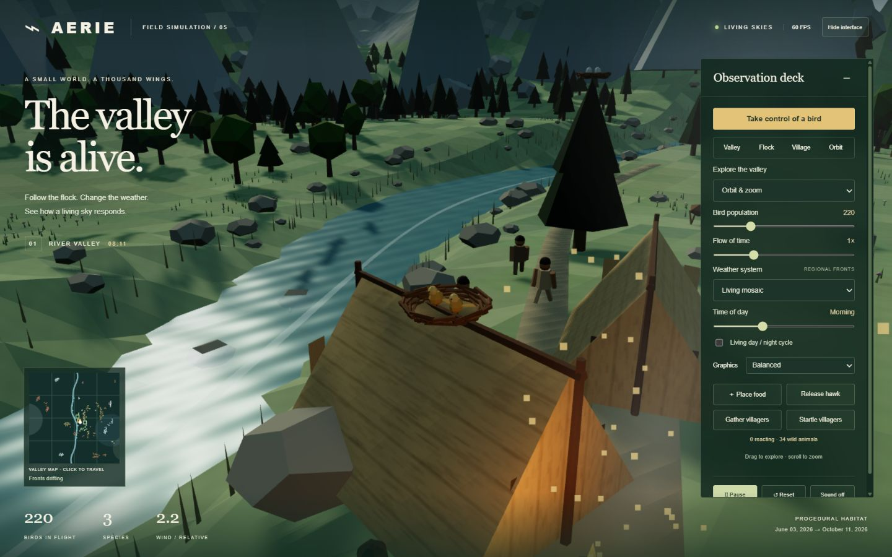

# AERIE — living skies

A bird habitat simulation with an early human village, built in two generations.

- **Original: June 3, 2026.** Recovered JavaScript Canvas simulation, preserved byte-for-byte in `original/`. Its three source hashes and verified request/completion timestamps are in `docs/provenance.json`. The old conversation summary says Pygame, but the recovered implementation is a browser simulation.
- **Advanced: October 10, 2026.** A procedural 3D valley with animated birds, three species, flock steering, regional weather, a tent settlement, walking villagers, campfire/smoke, and interactive cameras.

## Run

Install Node.js (no npm packages needed), then double-click `START-SIMULATION.cmd` on Windows. Or run:

```sh
node server.mjs
```

Open http://127.0.0.1:8787/advanced/ for the upgrade, http://127.0.0.1:8787/original/ for the original, or http://127.0.0.1:8787/ for the comparison. The original also opens directly as an HTML file. The advanced edition needs HTTP because it uses JavaScript modules. All runtime dependencies are vendored; internet is not needed.

## Living world expansion — October 10, 2026

The current advanced edition adds free flight, ground walking, bird viewpoint and a cinematic tour; a clickable valley map; drifting regional fronts and gradual weather changes; gathering/startling villagers, storm shelter and campfire activities; wider species-specific flight with energy, gliding and banking; feathered wings, beaks and forked tails; procedural sun/moon/stars, day/night cycling, wind animation, textured tent fabric, meadow detail and directional shadow maps.

**Graphics:** Light disables shadows and lowers pixel density. Balanced uses 1024-pixel shadow maps; Ultra uses 2048-pixel shadow maps and up to 2× pixel density. These are rasterized shadows, not hardware ray tracing.

## Playable bird expansion — October 10, 2026

Take control of a golden bird with a chase camera. Steer, climb, dive, flap and glide; approach real tree crowns or tent ridges and land with assistance. Perching restores energy, and flapping takes off. Landing practice buttons move you near a tree or tent without counting as a landing. The flight dashboard and map track your bird. Held buttons support touch controls.

Eight deer, twelve rabbits and fourteen river fish wander, graze, drink, shelter or scatter locally. Villagers watch a gentle visitor, wave at a chirp, duck or flee from close fast flybys. Weather shelter takes priority over curiosity.

Choose **Take control of a bird**. W/S or ↑/↓ climbs/dives; A/D or ←/→ steers; Space flaps; Shift glides; L lands/cancels/takes off; F chirps; P pauses. Focus the scene after using form controls. **Near a tree** and **Near a tent** make landing easy to learn. Exit flight or choose a habitat camera to return to observing.

## Nesting and first-person expansion — October 11, 2026

Version 4.0.0 adds a first-person camera for your own bird, three real-perch nests with two eggs each, a causal family cycle, foraging crowns and local flock friendships. Eggs hatch after twelve seconds of claimed-nest brooding; hungry chicks wait safely, and repeated feeding lets them grow and fledge after twenty-four nourished seconds. These are accelerated arcade timings.

Choose **Nest & flock** in your bird dashboard. Practice travel can approach Home nest or a Foraging tree, or place you beside the flock. It moves your adult bird only; claiming, incubation, food collection, feeding and fledging still require gameplay. Carry up to three meals; foraging crowns regrow after five seconds.

- V toggles first person/chase. W/S and A/D also let you look around while perched.
- E performs the displayed nest/food action: claim, collect or feed. Stay perched in a claimed nest to brood.
- F calls birds within fifty world units. B greets a bird within sixteen units into temporary companionship. G shares one carried meal, restores its energy and extends its stay.
- Flight and family/social progress pause together. Family clocks use real time, independent of the environment speed slider. Reset starts the family story again; no session save is implemented.
- Fledglings rise out of the nest and circle it as visible family birds. They remain separate from the 60–700 ambient-flock slider.

## Explore

- Drag and scroll to orbit/zoom. Valley and Village frame the landscape; Flock flies alongside one species.
- Change population (60–700), time speed, time of day, and the weather. Living mosaic has simultaneous regional fronts.
- Place food, then click the valley. Birds gather at that location.
- Release a hawk and watch nearby birds flee; recall it with the same button.
- Pause / resume, reset the deterministic habitat, or enable synthesized wind and bird calls.
- Choose Free flight or Walk in Explore the valley. WASD / arrow keys move, drag to look, Shift boosts; Q/E changes altitude in flight. Bird viewpoint follows an individual; Cinematic tour circles the valley.
- Click the map to travel. Gather/startle buttons arm a terrain click. Click near a person to read their activity.
- Hide interface keeps the world unobstructed; Escape restores it. Enable the day/night checkbox to advance the sun.
- Keyboard: P pauses; Space also pauses outside player flight, H toggles the hawk, R resets, when a form control is not focused.

## Source map

`nesting.js` owns eggs, food and chick growth; `nesting-view.js` renders their life stages; `bird-social.js` owns local calls and companion steering. `advanced/player-bird.js` owns player flight and landing; `flight-input.js` translates keys and held buttons; `player-view.js` renders your bird and chase camera; `wildlife.js` owns animal behavior. `advanced/model.js` owns deterministic flocking, species, weather forces, food and predator state. `weather.js` owns shared geographic fronts; `villagers.js` owns independent village behavior. `navigation.js` handles camera movement, `atmosphere.js` renders sky and lighting, `minimap.js` draws the map, and `audio.js` synthesizes sound. `terrain.js` supplies shared ground heights. `world.js` builds and animates the landscape, people, fire and local weather. `bird-view.js` draws wings/body instances; `main.js` owns the renderer, camera and controls. `index.html` and `styles.css` contain the interface. `server.mjs` is a local-only static server.

Run behavioral tests with `node --test tests/*.test.mjs`. These check reproducibility, finite/bounded motion, terrain clearance, and interaction effects. Browser visual checks are documented in `docs/verification.md` when complete.

This is a stylized behavioral simulation, not a scientifically calibrated aerodynamics or ecology model. The original files are intentionally untouched. New publication commits use the actual upload time, while the original creation date is recorded as provenance.

Three.js and OrbitControls retain their upstream MIT license; see `advanced/vendor/LICENSE`. Procedural scenery and synthesized audio need no external asset licenses.

## Dated GitHub history

- [Original source archive](https://github.com/TheGamingDonKey/bird-simulation/commit/929e269ea552c62e8abc09bbef96e72afed40c3a): June 3 source, published October 10.
- [First advanced edition](https://github.com/TheGamingDonKey/bird-simulation/commit/f0f29eae24c40ee3ef461f7c33a82a488866d997): October 10.
- [Living world expansion](https://github.com/TheGamingDonKey/bird-simulation/commit/7823c6317091f873d80ce0e65daff7224e2075b1): October 10.
- [Playable bird and wildlife expansion](https://github.com/TheGamingDonKey/bird-simulation/commit/227bdad504f17db083c9d5c68c11896df73c23bf): October 10.
- Current main: nesting and first-person expansion, October 11.



[First-person preview](first-person-preview.jpg) · [Family dashboard](nesting-preview.jpg) · [Completed fledging cycle](fledging-preview.jpg)
